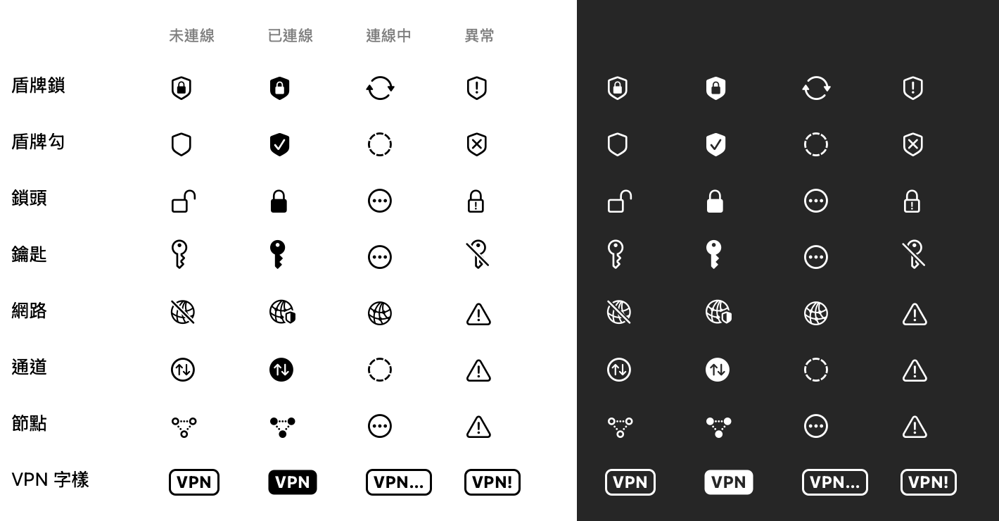

# SplitSwan

macOS 狀態列的 VPN 工具，用開源的 [strongSwan](https://www.strongswan.org) 連 **FortiGate IPsec VPN**（IKEv2、PSK＋EAP 帳密、Mode Config），可以用來取代 FortiClient。

- **Split tunnel**：只有指定網段走 VPN，Teams、Google Meet、一般上網都走原本的網路
- **三台閘道自動輪替**：依過去的連線紀錄，先試最近連得上、連得快的那台；連不上就換下一台
- **自動重連**：睡眠喚醒、切換網路、通道失聯後自動接回；按「斷線」後就不會再自動連線
- **斷線通知**：非預期中斷超過 30 秒時發 macOS 通知，恢復時再通知一次
- **診斷報告**：一鍵產生報告檔給管理者排查，不含密碼與 PSK
- **有圖形介面**：狀態列一鍵連線，主視窗有連線、設定、環境檢查、關於四個分頁，缺的元件可以一鍵安裝
- **公司設定與程式分開**：閘道與網段放在各自電腦的設定檔，原始碼不含任何公司位址

> 版本：1.8.5
>
> **Windows 版（beta）**：托盤 App，透過 WSL2 裡的 strongSwan 連線，功能與介面另有說明，見 [windows/README.md](windows/README.md)；下載請到 Releases 找 `SplitSwan-Windows-x.y.z.zip`。

## 跟 FortiClient 有什麼不同

| | FortiClient（全流量） | SplitSwan（split tunnel） |
|---|---|---|
| 哪些流量走 VPN | 全部（上網、視訊會議都繞去公司） | 只有公司設定檔列出的網段 |
| Teams／Google Meet | 視訊要先繞到公司再出去，延遲高、容易不穩 | 直接走本機網路，不經過 VPN |
| 多台閘道 | 手動切換 | 自動輪替 |

視訊會議的改善是依架構推論：通話流量不再經過 VPN 與公司閘道。實際效果還要看各自的網路環境。

**為什麼 FortiClient 不用設定網段？** 它其實也不知道公司網段，而是把全部流量都送進 VPN，交給公司閘道轉出去。SplitSwan 只讓公司網段走 VPN，所以要列出網段。如果 FortiGate 管理員在閘道上設定了 split tunnel 網段清單，未來可以改成直接採用閘道推送的清單。

## 系統需求

- **Apple Silicon Mac**（Homebrew 裝在 `/opt/homebrew`）。Intel Mac 不支援。
- macOS 14 以上
- [Homebrew](https://brew.sh)
- 公司 VPN 的帳號密碼，以及管理者提供的**加密設定檔**（`.splitswan`，含閘道、網段與預設共享金鑰）和它的**匯入密碼**。

## 安裝（使用者）

### 第一次安裝

先跟管理者拿兩樣東西：**加密設定檔**（`.splitswan`）與它的**匯入密碼**。另外準備好你自己的 VPN 帳號密碼。

1. **安裝 Homebrew**（已經裝過可以跳過）：打開「終端機」，貼上 [brew.sh](https://brew.sh) 首頁的安裝指令並照提示完成。裝好後執行 `brew --version` 有顯示版本就可以了
2. **下載 App**：到 [Releases](https://github.com/mark22013333/SplitSwan/releases/latest) 下載 `SplitSwan-<版本>.dmg`（不要下載 `SplitSwan-Windows-…` 開頭的檔案）
3. **安裝**：打開 dmg，把 SplitSwan 拖進「應用程式」資料夾。之後的一鍵更新需要 App 放在這裡
4. **第一次打開**：到「應用程式」點兩下 SplitSwan。macOS 會跳出「未打開 SplitSwan.app／Apple 無法驗證是否為惡意軟體」，這是因為 App 沒有經過 Apple 公證（只有 ad-hoc 簽章），**只有第一次會出現**。先按「完成」，再擇一處理：
   - 到「系統設定 → 隱私權與安全性」，往下捲到「安全性」，找到 SplitSwan 那一行，按「**仍要打開**」，輸入電腦密碼確認
   - 或在「終端機」執行：`xattr -dr com.apple.quarantine /Applications/SplitSwan.app`，再點兩下 SplitSwan
5. **環境檢查**：App 會開在「環境檢查」分頁，照紅燈由上往下逐項按「安裝」
   - strongSwan：在背景執行 `brew install strongswan`，約 1 分鐘
   - 系統元件：會跳出 macOS 管理員密碼視窗，輸入你的電腦密碼
6. **匯入公司設定**：到「設定」分頁按「**匯入設定檔…**」，選取 `.splitswan` 檔並輸入匯入密碼。閘道、網段與 PSK 會自動帶入，請核對閘道位址後再套用
7. **填帳號密碼**：在「設定」分頁填入你自己的使用者名稱與密碼，按「儲存」
8. **連線**：**先把 FortiClient 斷線**（兩個同時連會衝突），回「連線」分頁按「連線（自動輪替）」。狀態列圖示變成實心盾牌就是連上了
9. 建議順手做：「設定」頁打開「登入時自動啟動」；第一次斷線超過 30 秒時會詢問是否允許通知，請按「允許」

連不上時，到「環境檢查」頁按「產生診斷報告」，把桌面上的報告檔傳給管理者。連上了但某台公司主機打不開，見「[某台主機連不上怎麼辦](#某台主機連不上怎麼辦)」。

### 之後更新

- **1.7.0 以後**：「關於」頁按「檢查更新」，有新版本時按「下載並安裝」，App 會驗證簽章後自動替換並重新開啟，VPN 不會斷線，也不會再出現上面第 4 步的警告。想要自動提醒，可以勾選「每天自動檢查更新」（預設不勾選，不會自動安裝）
- **1.6.x 以前**：沒有一鍵更新，請照上面第 2～4 步手動下載安裝一次 1.7.0 以後的版本，設定會保留
- 如果新版有更新系統元件，「環境檢查」會顯示「需要更新」，按「更新」並輸入電腦密碼即可

### 使用

- 狀態列圖示：空心盾牌＝未連線、實心盾牌＝已連線、循環箭頭＝連線中、驚嘆號盾牌＝環境沒設好（點圖示選「開啟 SplitSwan 視窗」看環境檢查）
- 點狀態列圖示可以直接連線、斷線，或指定連 VPN1／VPN2／VPN3。每台閘道後面會顯示最近狀態，例如「上次 3.2 秒連上」「最近 3 次失敗」
- 自動輪替的順序：10 分鐘內失敗過的閘道排最後，上次成功的排第一，其餘依成功率與連線速度。「設定」頁可以「清除閘道連線紀錄」，恢復設定的順序
- 斷線通知：第一次需要時會詢問是否允許通知，請按「允許」。可以在「設定」頁關閉「VPN 中斷時通知」。手動斷線、睡眠喚醒後 30 秒內自動接回的情況不會通知
- 關掉視窗 App 會繼續在狀態列執行。要完全結束，從狀態列選「結束 SplitSwan」
- 連線失敗原因：連不上時「連線」頁會直接寫出原因，例如「帳號、密碼或預先共用金鑰（PSK）錯誤」「加密參數與閘道不符」「通道網段不被閘道接受」「閘道沒有回應或連不到」。系統元件是舊版時只會顯示「連線失敗」，到「環境檢查」按系統元件的「更新」即可
- 連線紀錄：「連線」頁下方可展開，顯示 strongSwan 的協商過程與 App 的動作（連線、重試、重建通道），可拷貝給管理者。App 的動作另外存在 `~/Library/Logs/SplitSwan/app.log`（只有自己能讀，超過 1 MB 自動只留最後一段），App 重開後仍可查
- 診斷報告：「環境檢查」頁按「產生診斷報告」，約數秒後在桌面產生 `SplitSwan-診斷-<時間>.txt` 並在 Finder 中選取，不會中斷連線。報告含 charon log 與 App 動作紀錄的最後一段，不含密碼與 PSK，但含閘道位址與通道網段，只傳給管理者
- 開機自動啟動：「設定」頁打開「登入時自動啟動」
- 版本與更新：「關於」頁顯示目前版本，可以拷貝版本資訊（回報問題時附上），按「檢查更新」會查 GitHub 上的最新版本。有新版本時按「下載並安裝」：App 會下載、驗證發布者的數位簽章，再取代目前的 App 並重新開啟，VPN 連線不會中斷；簽章不符就不安裝。勾選「每天自動檢查更新」（預設不勾選）會每天檢查一次，有新版本時顯示在狀態列選單，但不會自動安裝。App 要放在「應用程式」資料夾才能一鍵更新
- 輸入框支援 ⌘C／⌘V／⌘A；設定頁可用 ⌘S 儲存
- 狀態列圖示有 8 種樣式可選（「設定」頁的「狀態列圖示」），也可以設定已連線時顯示綠色：

  

## 公司設定檔（管理者）

閘道與通道網段不寫在程式裡，放在每台電腦的 `~/.config/splitswan/company.env`。管理者製作一份交給同事匯入即可。

### 建議：匯出加密設定檔

在自己已經設定好的 App 上，到「設定」頁按「**匯出加密設定檔…**」：

- 內容：閘道、通道網段、預設共享金鑰（PSK）。**不含**你個人的帳號密碼。
- 匯出時自訂一組密碼（至少 8 個字元）。檔案用 AES-256-GCM 加密，金鑰由密碼經 PBKDF2-SHA256（600,000 次）衍生；檔案被修改過就解不開。
- **把檔案與密碼分開傳送**（例：檔案用 email、密碼用 Teams 口頭告知），就算檔案外流也解不開。
- 同事按「匯入設定檔…」選取檔案、輸入密碼，App 會列出閘道與網段讓他確認，按「套用」才寫入。

### 也可以用明文的 company.env


1. 複製範本 [`config/company.env.example`](config/company.env.example) 成 `company.env`，填入實際值：
   ```bash
   SPLITSWAN_PRESET_NAME="我的公司"                         # 顯示在設定頁（選填）
   SPLITSWAN_GATEWAYS="203.0.113.10,203.0.113.20,203.0.113.30"   # 最多 3 台，逗號分隔
   SPLITSWAN_REMOTE_TS="10.0.0.0/24,198.51.100.5/32"           # 要走 VPN 的網段；單一主機寫 IP/32
   ```
2. 透過公司內部管道**私下**傳給同事（含公司位址，不要放進任何公開的地方）
3. 同事在「設定」頁按「匯入設定檔…」。App 會先驗證格式，通過後複製到 `~/.config/splitswan/company.env`（權限 600）。

App 取得閘道與網段的順序：

1. App 已儲存的設定
2. 既有的 strongSwan 設定檔（`/opt/homebrew/etc/swanctl/swanctl.conf`）
3. 公司設定檔 `~/.config/splitswan/company.env`
4. 環境變數 `SPLITSWAN_GATEWAYS`、`SPLITSWAN_REMOTE_TS`（只有從終端機啟動 App 時才讀得到，見下方說明）
5. 以上都沒有：留空，由使用者在設定頁自己填

「設定」頁的「從公司設定還原」會重新套用公司設定檔的值。改錯了，可以用它復原。

**關於 `~/.zshrc`**：從 Finder、Dock 或登入項目開啟的 macOS App 不會載入 `~/.zshrc`，所以 App 以公司設定檔為準。如果想讓終端機工具也用同一組值，可以在 `~/.zshrc` 加上：

```bash
[ -f ~/.config/splitswan/company.env ] && set -a && source ~/.config/splitswan/company.env && set +a
```

## 某台主機連不上怎麼辦

多半是那台主機不在通道網段裡，流量沒有走 VPN。

### 一鍵檢查（建議）

「設定」頁的「通道網段」卡片下方有「某台公司主機連不上？」：

1. 輸入主機網域、IP、`主機:連接埠`或整段網址（例如 `https://intranet.example.com:8443/page`），按「檢查並加入」（或直接按 Enter）
2. App 用系統 DNS 查出 IPv4。不在通道網段內的 IP 會直接以 `IP/32` 加入並儲存，不再另外確認；已連線時接著斷線重連（目前連線會中斷幾秒），沒有連線則只儲存，連線後生效
3. 重連後檢查每個 IP 的路由是否走 `utun`；有填連接埠會一併測試 TCP 能否連線。結果最上方列出「已加入：…」；加入的是公網 IP 時會以橘色警告提醒（可能是 DNS 沒走公司端，連到這個位址的流量都會改走 VPN）。IP 全部已在網段內時不改設定，直接檢查
4. 走 VPN 了還是不通：按「複製結果」，把內容（主機、IP、連接埠、路由與測試結果）傳給管理者，確認公司端有沒有開放。如果是全公司都需要的主機，請管理者加進 `company.env` 重新發給大家

只想看看、不想改設定時，按「只檢查」：只查 IP 並檢查路由與連接埠。有 IP 不在通道網段內時，結果會列出來並提供「加入並重新連線」（沒有連線時是「加入網段」）按鈕。結果頁的「再檢查一次」也一律只檢查，不會改設定。

IP 已經在通道網段內、路由卻沒走 `utun` 時，App 會查目前通道實際的網段來判斷：網段確實已生效，就提示「網段已在通道內，但目前路由沒走 VPN，可能是 VPN 服務（strongSwan）狀態異常」，並提供「重新連線」按鈕（見「已知問題」第 3 點）；系統元件不是最新版時改為提示先到「環境檢查」更新，重新連線後仍沒走 VPN 則提示產生診斷報告；網段尚未生效才顯示「確認網段已儲存且已重新連線」。

設定表單有還沒儲存的修改時，需要加入網段的動作（「檢查並加入」或結果頁的加入按鈕）會先擋下，請先按「儲存」或「還原」。

### 手動步驟

一鍵檢查失敗時，可以照下面步驟自己加（同樣的步驟也收在設定頁的「手動排查步驟」）：

1. **查出主機的 IP**：`dig +short 主機網域`
2. **加進通道網段**：「設定」頁通道網段加一行 `<IP>/32`（單一主機）或 `<網段>/24`，按「儲存」
3. **斷線再重新連線**。新網段要重新連線才會生效。
4. **確認有走 VPN**：`route -n get <IP>`，interface 那一行應該是 `utun` 開頭；是 `en0` 就代表沒走 VPN
5. 走 VPN 了還是不通：把 IP 和連接埠告訴管理者，確認公司端有沒有開放。

注意事項：
- **不要把通道網段改成 `0.0.0.0/0`**（全部流量走 VPN）。在 macOS 上這樣會讓一般上網的 DNS 解析失敗，外網會全斷（見「已知問題」）。
- 雲端 VM 的公用 IP 如果是動態的，重開機後可能會變。原本能連、突然不能連時，先用步驟 1 確認 IP 有沒有變。
- 如果本機網段（例如家裡路由器的網段）跟公司網段重疊，會互相衝突。

## 外掛

可以把與 VPN 無關的小工具（打卡提醒、會議倒數、CI 狀態…）寫成腳本，顯示在狀態列選單裡、必要時發通知。預設關閉，到「設定」頁的「外掛」區塊開啟。

狀態列選單固定保留單一「外掛」入口，內容依「外掛 → 單支外掛 → 輸出項目」分層。功能關閉時會顯示「外掛功能未啟用」；功能已開啟但沒有可用外掛時會顯示「沒有可用的外掛」。根選單底部固定提供「外掛設定…」與「全部重新整理」；前者會開啟設定頁的外掛區塊，後者會重新掃描並執行所有外掛（功能關閉時不可操作）。

> **⚠️ 外掛以你本人的身分執行。** 它能讀到你的 VPN 帳號密碼與 PSK（`secrets.conf`）、能透過輔助程式連線或斷線，也能存取你帳號下的所有檔案。**只安裝你信任、而且看得懂內容的腳本**；不要把網路上下載的腳本直接放進外掛資料夾。

### 放在哪裡

- 外掛資料夾：`~/.config/splitswan/plugins/`。App 不會自己建立，按設定頁的「開啟外掛資料夾」才建立（權限 700）。
- 外掛直接執行（不經 shell），所以**第一行必須是 shebang**，例如 `#!/bin/bash` 或 `#!/usr/bin/env python3`；沒有 shebang 的腳本會顯示「無法執行」。
- 資料夾內每個**可執行的一般檔案**就是一個外掛；隱藏檔、不可執行的檔案、子資料夾都略過。最多 10 個，超過的依檔名排序後略過，設定頁會列出來。
- 檔名格式同 SwiftBar：`<名稱>.<間隔>.<副檔名>`，例如 `punch-reminder.1m.sh`。間隔可寫 `30s`、`1m`、`5m`、`1h`、`1d`，最短 30 秒（寫更短也當 30 秒）；沒寫間隔就是 5 分鐘。
- App 啟動、打開設定頁、按「立即重新整理」時各跑一次，之後依間隔執行；同一個外掛上一次還沒跑完不會重複執行，同時最多執行 2 個外掛，其餘排隊。
- 睡眠、螢幕關閉、螢幕鎖定、螢幕保護程式期間暫停所有外掛；喚醒且解鎖後各跑一次再恢復排程（例：打卡提醒會在解鎖後立刻補發）。
- 外掛資料夾有新增、移除或改名時會自動重新掃描（監看資料夾的系統事件，不輪詢）。只改權限（`chmod`）不會觸發，下次執行時會重新檢查。

#### 效能

外掛預設關閉。關閉時不建立任何計時器、不掃描資料夾、不建立狀態資料夾、不訂閱任何系統事件，等於沒有這個功能。開啟後每個外掛一個計時器（容許 10% 誤差讓系統合併喚醒），執行與解析都在背景低優先權進行，選單只在外掛輸出真的變了才重建。

### 輸出格式（SwiftBar 的子集）

```
標題
---
一般項目
有顏色的項目 | color=red
開網頁 | href=https://example.com/punch
執行腳本 | bash=/Users/me/.config/splitswan/plugins/x.sh param1=mark param2=in refresh=true
有子選單
--子項目
---
提醒 | notify=true notify_id=reminder-1 href=https://example.com/punch
```

- 第一個 `---` 之前的第一行是該外掛在第二層選單的標題，其餘 header 行忽略。`---` 之後每行一個輸出項目，單獨一行 `---` 是分隔線，`--` 開頭是上一個項目的子選單（只支援一層）。
- `|` 之後是空白分隔的 `key=value`，值有空白時用雙引號包起來。支援的參數：

| 參數 | 說明 |
|------|------|
| `href=<網址>` | 點擊開網址，只接受 `http`、`https`，且不可含帳密（`user:pw@`） |
| `bash=<絕對路徑>`、`param1=`…`param9=` | 點擊時執行該程式（不開終端機，`terminal=` 忽略）。解析 symlink 後**只能是外掛本身**（寫 `bash="$0"`）；外掛資料夾裡的其他檔案、`/bin/sh`、Homebrew 的 `python3` 等一律拒絕。取得執行名額後、執行前會再做一次完整檢查 |
| `refresh=true` | 點擊的動作完成後立刻重跑這個外掛 |
| `color=<#RRGGBB 或 red／orange／green／gray>` | 文字顏色 |
| `notify=true`（SplitSwan 擴充） | 這一行另外發成通知：標題固定為「外掛：<檔名中的名稱>」（外掛無法冒充 SplitSwan 自己的通知），外掛輸出的標題放在副標題，內文是這一行的文字；點通知時若這行有 `href` 就開啟 |
| `notify_id=<字串>`（SplitSwan 擴充） | 通知去重鍵，沒寫就用該行文字；超過 64 字元改用雜湊。同一外掛同一個鍵**每天只發一次**（本地日期）；每次執行最多發 3 則，每個外掛每天最多 20 個不同的鍵，達上限當天不再發，設定頁會標示 |

不支援的參數一律忽略。外掛結束碼不是 0、逾時或權限不符時，該外掛標題後面會加「⚠︎」，子選單只顯示原因（結束碼與 stderr 最後一行），不顯示不可採信的輸出。只有點擊動作失敗時，標題同樣加「⚠︎」，但會先顯示失敗原因，再保留上次成功的輸出項目。點擊動作與排程執行不會同時跑同一個外掛。

### 安全規則

- 外掛以你的身分執行，**絕不經過 sudo 或輔助程式**。只放你看得懂的腳本。
- 執行前檢查（掃描、每次執行、點擊動作執行前都會做），不通過就不執行並在設定頁顯示原因：
  - 外掛檔（symlink 解析後）必須就在外掛資料夾第一層，指到資料夾外（例：指向 `python3`）一律拒絕。
  - 外掛檔與外掛資料夾必須屬於你、不可被 group／other 寫入，也不可有允許其他人寫入的 ACL（`ls -le` 可查看，`chmod -N` 可移除）。
  - 外掛資料夾以上每一層直到 `/` 都必須屬於你或 root，且不可被他人寫入（設了 sticky bit 的 `/tmp` 這類例外），也不可有允許他人寫入的 ACL。
  - 帶有下載隔離標記（`com.apple.quarantine`）的檔案不執行。確認內容沒問題後，可以自行執行 `xattr -d com.apple.quarantine <檔案>` 移除標記。
- 直接執行檔案本身，不把任何內容拼進 shell 指令。每次限時 10 秒，逾時先送 SIGTERM、1 秒後 SIGKILL。只會結束外掛本身：外掛另外啟動、而且忽略 SIGTERM 的子程序，逾時後可能留在背景。
- 環境變數只給：`PATH=/opt/homebrew/bin:/usr/local/bin:/usr/bin:/bin:/usr/sbin:/sbin`、`HOME`、`SPLITSWAN=1`、`SPLITSWAN_PLUGIN_STATE`（`~/.config/splitswan/plugin-state/<完整檔名>`，App 建立，權限 700，可放外掛自己的狀態）。不傳 VPN 設定或任何秘密。stderr 另外收集，只保留最後 4 KB，用來顯示錯誤原因（最後一行）、不寫檔。
- 外掛輸出視為不受信任的資料：讀取時最多保留 64 KB，之後的輸出直接丟棄（仍持續讀取，外掛不會卡住），最多顯示 30 個項目；每個項目的文字最多 200 字、600 bytes，並去掉控制字元、方向控制字元與換行類字元；`href` 只接受 http／https 且不可含帳密，`bash=` 只接受外掛本身。
- 每日通知去重紀錄每個外掛一份，存在 `~/.config/splitswan/plugin-state/.notified/<完整檔名>.json`（600），只保留當天、最多 20 個鍵。
- 關閉外掛或進入睡眠／鎖定後，排隊中的外掛不會開始，執行到一半的結果直接丟棄（不更新選單、不發通知）；之後重新開啟或解鎖時，若那次還沒結束，會等它結束後立刻補跑一次。
- 文字過濾保留 ZWJ（U+200D）與 tag 字元（U+E0020–E007F），組合 emoji（例：👨‍💻、旗幟）可以正常顯示。

### 範例：打卡提醒

[`config/plugins/punch-reminder.1m.sh.example`](config/plugins/punch-reminder.1m.sh.example) 是彈性上班（08:30–09:00 打卡、下班＝上班＋10 小時）的提醒範例：上班提醒兩次（08:30、08:50），下班時間到了提醒一次、再過 30 分鐘還沒標記就用紅字再提醒一次。打卡後在選單點「標記上班已打卡」「標記下班已打卡」停止提醒。

```bash
mkdir -p ~/.config/splitswan/plugins && chmod 700 ~/.config/splitswan/plugins
cp config/plugins/punch-reminder.1m.sh.example ~/.config/splitswan/plugins/punch-reminder.1m.sh
chmod 700 ~/.config/splitswan/plugins/punch-reminder.1m.sh
# 編輯檔案開頭的 PUNCH_URL（打卡頁網址）與時間設定
```

**哪天要上班**依序判斷：

1. **覆寫檔** `~/.config/splitswan/punch-overrides.txt`（沒有就略過）：每行 `YYYY-MM-DD off|work [說明]`，`#` 開頭是註解，格式不對的行忽略。例：
   ```
   # 特休
   2026-10-12 off 特休
   # 國定假日要加班
   2026-10-10 work 加班
   ```
   檔案必須屬於你、他人不可寫（`chmod 600`），否則整份忽略，選單會提示。
2. **政府行政機關辦公日曆表**（腳本開頭 `HOLIDAY_SOURCE="tw-gov"`，設成 `none` 就停用）：資料來源是政府資料開放平臺 data.gov.tw 資料集 14718。腳本從清單（最多 100 筆）挑「<民國年>年中華民國政府行政機關辦公日曆表」、格式為 CSV 的項目，排除 Google 行事曆版與描述或網址含控制字元的項目，依上傳時間由新到舊最多試 2 個；只接受 www.dgpa.gov.tw／data.gov.tw 的 https 網址。下載後只採用格式正確（`日期,星期,0或2,備註`）、日期不重複且涵蓋全年每一天的資料，快取在狀態資料夾的 `calendar-<西元年>.csv`，7 天更新一次。每次開始抓取前先記下失敗時間，成功才清除，所以抓取失敗或被逾時中斷時會沿用舊快取、6 小時內不重試。選單的「重新抓取日曆」會立刻重抓。連網只用 curl（清單限 5 秒、每個 CSV 限 1.5 秒，合計 ≤ 8 秒）。
3. 都沒有就用 `WORKDAYS`（週一到週五）。

放假日選單顯示「今天放假：<備註或週末>」；下方灰字顯示日曆來源，例如「日曆：政府 115 年（更新於 10-10）」「日曆：覆寫」「日曆：抓取失敗，暫用週一至週五」。

腳本可以不靠 App 直接測：`NOW=08:55 TODAY=2026-10-09 DOW=5 SPLITSWAN_PLUGIN_STATE=/tmp/punch-test bash punch-reminder.1m.sh`。離線測試可再加 `CAL_API_FILE=<清單 JSON> CAL_CSV_FILE=<日曆 CSV>`（設定時完全不連網），或 `HOLIDAY_SOURCE=none`。

## 疑難排解

| 狀況 | 處理方式 |
|------|----------|
| 圖示一直是驚嘆號盾牌 | 開視窗到「環境檢查」，把紅燈逐項按「安裝」 |
| 環境檢查顯示「尚未設定閘道或通道網段」 | 「設定」頁按「匯入設定檔…」 |
| 三台閘道都連不上 | 先看「連線」頁顯示的失敗原因。原因不明時到「環境檢查」頁按「產生診斷報告」，把桌面上的報告檔傳給管理者；也可以展開「連線」頁下方的「連線紀錄」看卡在哪一步。最常見的是密碼或 PSK 打錯（顯示「帳號、密碼或預先共用金鑰（PSK）錯誤」，charon log 會出現 `AUTHENTICATION_FAILED`），或 FortiClient 還連著 |
| 顯示「輔助程式沒有回應，已逾時中止」 | strongSwan 卡住了。App 會照常自動重試；一直出現時，把 Mac 重新開機，或產生診斷報告給管理者 |
| 沒有收到斷線通知 | 到「系統設定 → 通知 → SplitSwan」確認允許通知；「設定」頁的「VPN 中斷時通知」要打開 |
| 連上後某台主機不通 | 見「某台主機連不上怎麼辦」 |
| 顯示已連線，但所有公司主機都不通 | 可能是路由沒走 VPN（見「已知問題」第 3 點）：`route -n get <公司主機 IP>` 的 interface 是 `en0`，且 `sudo swanctl --list-sas` 的 CHILD_SA 收送 bytes 都是 0。新版系統元件連線時會自動偵測並重啟 strongSwan 再連一次；仍是如此時，按「斷線」再「連線」，或在設定頁「某台公司主機連不上？」按「只檢查」後按「重新連線」 |
| 連上後外網全斷 | 通道網段被改成 `0.0.0.0/0` 了，按「從公司設定還原」 |
| 系統元件顯示「需要更新」 | 更新 App 後內附的元件可能跟著更新，按「更新」重新授權一次 |
| 診斷報告顯示「找不到 log 檔」 | 系統元件是舊版，到「環境檢查」按「更新」，再重新連線一次，之後的連線過程才會寫進 log |
| 外掛顯示「可被其他使用者寫入」 | 對外掛檔案與外掛資料夾執行 `chmod go-w`；外掛資料夾建議 `chmod 700` |
| 外掛顯示「下載隔離標記」 | 確認腳本內容沒問題後執行 `xattr -d com.apple.quarantine <檔案>` |
| 外掛顯示「有 ACL 允許其他使用者寫入」 | 對該檔案或資料夾執行 `chmod -N` 移除 ACL |
| 外掛顯示「實際檔案不在外掛資料夾內」 | 外掛是 symlink 指到資料夾外；請把實際檔案放進外掛資料夾 |
| 外掛沒有出現在選單 | 設定頁「外掛」要開啟；檔案要可執行（`chmod u+x`）；隱藏檔與 `.example` 結尾不可執行的範例不會被當成外掛 |
| 存檔時顯示格式錯誤 | 訊息會指出是哪個欄位；網段要寫成 `a.b.c.d/遮罩`，用半形數字，不可用 `/0` |

## 解除安裝

```bash
sudo rm /etc/sudoers.d/splitswan /usr/local/libexec/splitswan-helper
rm -f /opt/homebrew/etc/strongswan.d/splitswan.conf
sudo rm -r /var/log/splitswan
rm -r /Applications/SplitSwan.app ~/.config/splitswan
brew uninstall strongswan
# 確認 /opt/homebrew/etc/swanctl 是否還在；裡面有密碼檔，不需要的話手動刪除
```

如果開過「登入時自動啟動」，先在設定頁關掉，或到「系統設定 → 一般 → 登入項目」移除。

---

## 開發

### 編譯與打包

需求：Xcode Command Line Tools（Swift 6.1 以上）。

```bash
bash build.sh             # 編譯到 build/SplitSwan.app
bash build.sh --install   # 編譯並安裝到 /Applications（會先結束正在執行的 App）
bash make-dmg.sh          # 編譯並打包成 dist/SplitSwan-<版本>.dmg
```

- 版本號在 `build.sh` 開頭的 `VERSION`、`BUILD_NUM`。
- 單元測試：`bash Tests/run-tests.sh`（不連 VPN、不需要 sudo、不寫入系統設定）。涵蓋自動重連、斷線通知判定、閘道排序、加密匯出入、注入攻擊回歸測試、網段格式轉換、診斷報告的密碼遮蔽、檢查更新的版本比較、一鍵更新的簽章驗證與替換流程。
- 輔助程式 `logtrim` 的截斷測試：`bash tools/test-logtrim.sh`（一般權限，在暫存目錄操作副本）。
- 輔助程式連線失敗原因分類的測試：`bash tools/test-classify.sh`（一般權限，用假的 swanctl 跑副本，不連 VPN）。
- 輔助程式「路由沒走 utun 時重啟 charon」的測試：`bash tools/test-stale-route.sh`（一般權限，用假的 swanctl、charon、route 跑副本，不連 VPN、不碰真的 charon）。
- 自動重連的實機測試：`sudo bash tools/test-dpd.sh`（暫時封鎖閘道，量失聯偵測與恢復秒數；斷線通知要在測試期間人工確認），驗收清單與結果見 [`docs/F1-實機驗收.md`](docs/F1-實機驗收.md)。
- 開發時可以用 `open build/SplitSwan.app --args -InitialTab settings`（或 `environment`、`about`），直接開在指定分頁。
- 外掛的單元與整合測試在 `run-tests.sh` 的 `plugins` 組（在暫存目錄放假外掛實跑，不碰 `~/.config/splitswan`）；打卡範例的測試：`bash tools/test-punch-example.sh`。
- 測試外掛時不要動到自己的外掛資料夾，用啟動參數換掉路徑（只對這次啟動有效，不寫入設定）：
  `open -n build/SplitSwan.app --args -PluginsEnabled YES -PluginsDir /絕對路徑/plugins -PluginStateDir /絕對路徑/state -WantConnected NO`。
  `-WantConnected NO` 讓 build 版不會自動連線（它和 /Applications 的版本共用設定）。路徑必須是絕對路徑，資料夾權限要 700。

### 改名

App 顯示名稱與 bundle id 在 [`app.env`](app.env)，改完重新編譯即可。Swift 程式從 `Info.plist` 讀名稱，不用改程式碼。

改 bundle id 之後，App 存的設定與登入項目會重新開始，strongSwan 設定檔與公司設定檔不受影響。

下列是內部識別字，改名時**不一定要改**；要改的話請一併修改：

| 識別字 | 出現位置 |
|--------|----------|
| 輔助程式 `/usr/local/libexec/splitswan-helper` | `splitswan-helper`、`install-root.sh`、`Sources/VPNController.swift`、`Sources/EnvChecker.swift`、`diag.sh`、`build.sh` |
| sudoers 規則 `/etc/sudoers.d/splitswan` | `install-root.sh` |
| charon log `/var/log/splitswan/charon.log` | `splitswan-helper`、`install-root.sh`、`Sources/ConfigStore.swift`、`Sources/DiagnosticRunner.swift` |
| 公司設定檔 `~/.config/splitswan/company.env` | `Sources/CompanyPreset.swift` |
| 環境變數前綴 `SPLITSWAN_` | `Sources/CompanyPreset.swift`、`config/company.env.example` |

### 架構

```
SplitSwan.app（狀態列＋主視窗，一般使用者權限）
   │  ├─ 讀 ~/.config/splitswan/company.env（公司設定）
   │  ├─ 直接讀寫 /opt/homebrew/etc/swanctl/{swanctl.conf, conf.d/secrets.conf}
   │  ├─ 直接寫 /opt/homebrew/etc/strongswan.d/splitswan.conf（重送參數與 filelog）
   │  ├─ 直接讀 /var/log/splitswan/charon.log（診斷報告用）
   │  └─ sudo -n（sudoers 只對這一支程式免密碼）
   ▼
/usr/local/libexec/splitswan-helper（root 擁有的輔助程式，只接受固定幾種參數）
   │
   ▼
swanctl ──vici──▶ charon（strongSwan daemon，root）──IKEv2──▶ FortiGate
```

- App 本身不碰 root 權限，需要 root 的動作都集中在輔助程式裡。它只接受 `status`、`up [auto|1|2|3]`、`down`、`reload`、`reload-settings`、`log`、`sas`、`logtrim`，其他參數一律拒絕。
- 設定檔放在使用者可寫入的目錄，App 直接寫入，存檔後呼叫 `reload` 讓 charon 重新載入。已經連著的通道不受影響，下次連線才套用。重送參數與 log 設定改變時另外呼叫 `reload-settings`。
- charon 的 log 寫到 `/var/log/splitswan/charon.log`（等級 1，不含金鑰）。目錄由 `install-root.sh` 建立並歸 root 所有；檔案沒有輪替功能，改由輔助程式 `logtrim` 在每次連線前與每小時檢查，超過 2 MB 時就地截斷成最後 1 MB。
- 系統元件的安裝腳本內附在 App 裡（`Contents/Resources/install-root.sh`），由「環境檢查」頁透過 macOS 管理員授權執行。App 會比對已安裝的輔助程式與內附版本，不同就顯示「需要更新」。

### VPN 參數

| 項目 | 值 |
|------|----|
| 協定 | IPsec IKEv2，Mode Config |
| 驗證 | 閘道用預設共享金鑰（PSK），使用者用 EAP 帳密 |
| Phase 1 | AES128／AES256 + SHA256，DH 20（ecp384），金鑰有效期 86400 秒，開啟 DPD |
| Phase 2 | AES128／AES256 + SHA256，金鑰有效期 43200 秒；同時接受有／無 PFS |

這組參數對應 FortiClient「IPsec VPN」連線的常見設定，寫在 `Sources/ConfigStore.swift` 的 `renderConf`。如果你的 FortiGate 用不同的加密參數，要改這裡。

### 檔案說明

| 檔案 | 用途 |
|------|------|
| `app.env` | App 名稱與 bundle id |
| `Sources/main.swift` | 程式進入點、狀態列選單、視窗管理 |
| `Sources/MainView.swift` | 主視窗四個分頁（SwiftUI） |
| `Sources/VPNController.swift` | 呼叫輔助程式、定時更新連線狀態、自動重連、斷線通知判定 |
| `Sources/DropNotifier.swift` | 發送 macOS 斷線／恢復通知 |
| `Sources/GatewayHistory.swift` | 閘道連線紀錄與自動輪替排序 |
| `Sources/DiagnosticReport.swift` | 診斷報告的組字與密碼遮蔽（純函式） |
| `Sources/DiagnosticRunner.swift` | 收集診斷資料（限時執行外部指令）並寫出報告 |
| `Sources/ConfigStore.swift` | 產生與讀取 swanctl.conf、secrets.conf；驗證輸入 |
| `Sources/CompanyPreset.swift` | 讀取與匯入公司設定檔、環境變數 |
| `Sources/ConfigExport.swift` | 加密設定檔（`.splitswan`）的匯出與匯入 |
| `Sources/MenuBarIcon.swift` | 狀態列圖示的 8 種樣式 |
| `Sources/EnvChecker.swift` | 環境檢查與一鍵安裝 |
| `Sources/AppInfo.swift` | 從 Info.plist 讀 App 名稱與版本；GitHub repo 位址 |
| `Sources/AboutInfo.swift` | 「關於」頁的版本資訊與檢查更新（版本比較、解析 GitHub 回應） |
| `Sources/PluginLogic.swift` | 外掛的純邏輯：檔名間隔、輸出解析、href／bash 驗證、通知去重、權限判斷 |
| `Sources/PluginRunner.swift` | 外掛的掃描、權限檢查、限時執行與排程 |
| `Sources/PluginMenu.swift`、`PluginSettingsView.swift` | 外掛階層選單的純投影與 AppKit 轉接、設定頁的「外掛」區塊 |
| `Sources/UpdateCenter.swift`、`UpdateInstaller.swift`、`UpdateLogic.swift` | 一鍵更新與每日自動檢查：下載、Ed25519 簽章驗證、檢查與替換 App |
| `tools/release-sign.swift` | 發版時簽署 dmg（私鑰不在 repo） |
| `tools/make-icon.swift` | 產生 App 圖示 |
| `tools/test-dpd.sh` | 實機測試自動重連：暫時封鎖閘道，量失聯偵測與恢復秒數（需 sudo） |
| `tools/test-logtrim.sh` | 測試輔助程式的 `logtrim` 截斷（一般權限，使用副本） |
| `tools/test-classify.sh` | 測試輔助程式的連線失敗原因分類與 `up` 輸出格式（一般權限，使用副本與假 swanctl） |
| `tools/test-stale-route.sh` | 測試輔助程式 `up` 的路由檢查與重啟 charon（一般權限，使用副本與假 swanctl／charon／route） |
| `build.sh` | 編譯、產生圖示、內附系統元件、ad-hoc 簽章 |
| `make-dmg.sh` | 打包 .dmg |
| `splitswan-helper` | root 輔助程式 |
| `install-root.sh` | 安裝輔助程式、sudoers 規則與 log 目錄（App 內附，也可以手動 `sudo bash install-root.sh`） |
| `vpn.sh` | 命令列版本（每次會要求輸入 sudo 密碼） |
| `diag.sh` | 連線診斷：自動連線、收集路由／DNS／SA，測試通道網段內的目標與外網，再自動斷線 |
| `config/company.env.example` | 公司設定檔範本 |
| `config/secrets.conf.example` | strongSwan 密碼檔範本（參考用，App 會自動產生） |
| `config/plugins/punch-reminder.1m.sh.example` | 外掛範例：打卡提醒 |
| `tools/test-punch-example.sh` | 測試打卡提醒範例（暫存 state 目錄、覆寫時間） |

### 安全

- **PSK 與密碼只存在 `/opt/homebrew/etc/swanctl/conf.d/secrets.conf`**（權限 600），公司位址只存在 `~/.config/splitswan/company.env`（權限 600），兩者都不在 repo 裡。
- 加密設定檔的安全性取決於匯出密碼的強度，請用不容易猜到的密碼，並與檔案分開傳送。
- **加密只保密，不證明來源**：有人可以自己做一份 `.splitswan`，把閘道換成他的主機，再連同密碼騙你匯入，你的 VPN 帳號密碼就會送過去。所以匯入時 App 會列出閘道與網段要你確認；**只匯入管理者親自給的檔案**，並核對閘道位址。
- 匯入的內容一律嚴格驗證（閘道最多 3 台、只接受 IP／網域字元、網段逐筆檢查、拒絕 `/0` 與控制字元），`company.env` 一律由驗證後的值重新產生，值用單引號包住，被 shell `source` 時不會執行任何內容。
- App 的設定頁不會顯示已存的密碼，欄位留空代表沿用原本的值。
- 診斷報告寫入前會遮蔽密碼與 PSK：先用規則把 `secret`、`password`、`PSK`、`EAP` 等欄位的值換成 `***`，再把目前設定中 6 個字元以上的實際密碼與 PSK 精確取代。報告檔權限 600，但含閘道位址與通道網段，只傳給管理者。
- charon log 等級固定為 1（基本控制訊息），不含金鑰。log 檔權限 644，本機其他帳號也能讀到連線過程與閘道位址。
- 輸入會先驗證再寫入：帳號、閘道、網段只接受固定字元，避免換行、大括號等字元破壞設定檔結構；密碼與 PSK 會跳脫雙引號與反斜線。匯入的公司設定檔也用同一套規則驗證。
- 外掛以使用者身分執行、不經 sudo；執行前檢查擁有者與寫入權限，輸出當成不受信任的資料處理（見「外掛」段）。
- 免密碼 sudo 只放行 `/usr/local/libexec/splitswan-helper`。它是 root 擁有，一般使用者改不了。
- 已知限制：Homebrew 安裝的 `charon`、`swanctl` 放在一般使用者可寫入的 `/opt/homebrew` 底下，被替換的話仍然能透過輔助程式取得 root。`/opt/homebrew/etc/strongswan.d/` 同樣可由一般使用者寫入，有心人可以改掉 filelog 路徑，讓以 root 執行的 charon 寫入任意檔案。改用每次輸入密碼也有同樣的風險，差別只在於需要使用者當下在場輸入。

### 已知問題

1. **全流量模式（`0.0.0.0/0`）下 DNS 失敗**（未解決）
   - 連線本身正常，直接問 DNS 伺服器（`dig @<DNS>`）也正常，但 macOS 系統解析失敗，curl 顯示「Resolving timed out」。
   - 差異在於 strongSwan 把 DNS 加到 Wi-Fi（`en0`）的設定裡，讓系統解析綁在 `en0` 送出；FortiClient 則是綁在自己的 VPN 介面上。綁在 `en0` 為什麼會失敗，還沒查清楚。
   - 已排除的原因：閘道擋外網（同一個閘道用 FortiClient 全流量時外網正常）、MTU（VPN 下不可切割的封包一路通到 1400 bytes）。
2. **登入時自動啟動是否會跳視窗**（待確認）：App 用 Apple Event 判斷是不是登入時啟動，這對 `SMAppService` 註冊的登入項目是否有效還沒實測。就算跳出來，關掉視窗即可。
3. **路由沒走 VPN（strongSwan 長時間執行後）**（已有自動處置，成因未查證）
   - 現象：IKE 與 CHILD_SA 都建立了、App 顯示已連線，但 charon 把遠端網段的路由裝到實體介面（`en0`，下一跳是家裡的路由器），沒有裝到虛擬 IP 所在的 `utun`，公司主機全部連不上。
   - 判斷方式：`route -n get <公司主機 IP>` 的 interface 是 `en0` 而不是 `utun`；`sudo swanctl --list-sas` 的 CHILD_SA 收送 bytes 都是 0。
   - 曾觀察到的條件：charon 已連續執行數天、經過多次睡眠喚醒與虛擬網卡增減。只斷線再連線（即使等 `utun` 介面消失）仍然一樣，重新啟動 charon 後路由恢復走 `utun`。
   - App 的處置：輔助程式 `up` 連上後，用 `route -n get` 檢查 CHILD_SA 每一個遠端網段的路由（IPv6、位址範圍、`/0`，以及與本機網路直接相連網段重疊的會略過）；任一個不是 `utun` 就全部斷線、結束 charon（只結束執行檔路徑相符、而且以 root 執行的那一支；一般結束沒有回應時才強制結束，連線紀錄會提醒必要時重新開機）、重新啟動並載入設定、再連同一台，只做一次。修復期間不發斷線通知。連線紀錄會寫「偵測到路由沒走 VPN，已重啟 strongSwan 並重新連線」；重啟後仍未恢復時，「連線」頁會顯示提示。

## 授權

[MIT](LICENSE)。

SplitSwan 以獨立程序呼叫 [strongSwan](https://www.strongswan.org)（GPLv2），沒有連結或散布它的程式碼；strongSwan 由使用者自行透過 Homebrew 安裝。FortiGate、FortiClient 是 Fortinet 的商標，本專案與 Fortinet 無關。
